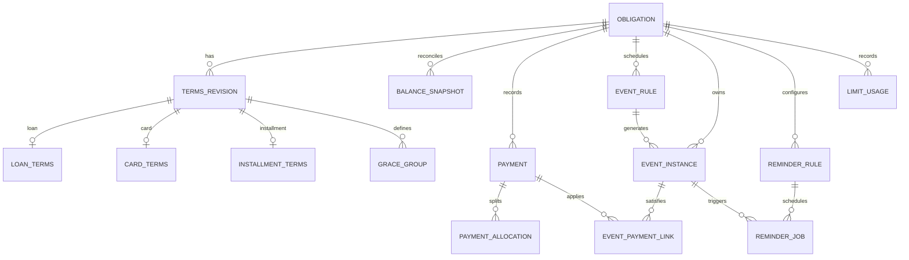

# Логическая модель данных v1.0

Room/SQLite, схема подлежит реализации и миграционным тестам. UUID text (или согласованное бинарное представление), даты ISO LocalDate; технические timestamps UTC epoch ms; часовые пояса IANA. Money: currency code + signed 64-bit minor units, фиксированная шкала из версии справочника валют; overflow check. Ставки decimal string, не REAL. Nullable = неизвестно, не ноль. Факты и оценки различаются.

## ER-диаграмма

## Сущности
Общие audit поля createdAt/updatedAt на изменяемых записях. Идентификатор операции уникален для повторяемых команд.

| Таблица | Основные поля и ограничения |
|---|---|
| obligation | id PK, title, lenderLabel, type, currency, openedOn?, status ACTIVE/CLOSED/ARCHIVED, bankZoneId, notes?, closedOn?, archivedAt? |
| terms_revision | id PK, obligationId FK, effectiveFrom, revisionNo, provenance USER/BANK, notes; UNIQUE(obligationId,revisionNo); история неизменна после активации |
| loan_terms | termsId PK/FK, originalPrincipal?, annualRate?, rateMethod?, termMonths?, paymentScheme, scheduledPayment?, firstDueDate?, prepaymentMode?, fees? |
| card_terms | termsId PK/FK, creditLimit?, statementRule?, minimumRule?, cashFeeFreeLimit?, cashResetRule?, rate/fee policy refs or validated versioned config; no PAN/CVV |
| installment_terms | termsId PK/FK, originalAmount?, downPayment?, installmentCount?, annualRate?, fees?, scheduleMode |
| grace_group | id PK, termsId FK, category, amountToPreserveGrace?, deadline?, sourceStatementDate?, conditionsKnown, versioned conditions; explicit dates in MVP |
| balance_snapshot | id PK, obligationId FK, bankAsOfDate, recordedAt, source USER_CONFIRMED/BANK_STATEMENT, principal?, totalDebt?, interest?, fees?, payoffAmount?, availableCredit?, currency; append-only, correction via supersedesId |
| payment | id PK, operationId UNIQUE, obligationId FK, amount, currency, paidOn, status ACTIVE/REVERSED, note?, supersedesId?, recordedAt; corrections via reversal/replacement |
| payment_allocation | id PK, paymentId FK, component PRINCIPAL/INTEREST/FEE/UNALLOCATED, amount; sum allocations equals payment amount when recorded; unknown portion explicit |
| event_rule | id PK, obligationId FK, type, stableSeriesId, revision, effectiveFrom, effectiveTo?, recurrenceKind, validated versioned recurrence config, amount?, currency?, bankZoneId, enabled, dueCutoff?, monetaryRole, alternativeGroupKey? |
| event_instance | id PK, obligationId FK, eventRuleId FK nullable for manual, occurrenceKey UNIQUE, nominalDate, dueDate, dueCutoff?, amount?, currency?, provenance, state, manualOverride, generatedRevision, alternativeGroupKey?, monetaryRole |
| event_payment_link | id PK, eventId FK, paymentId FK, allocatedAmount, currency; UNIQUE(eventId,paymentId); sum across obligations/events constrained, no double count |
| reminder_rule | id PK, obligationId FK nullable for global, eventType?, eventId? override, offsetDays, localTime, timeZonePolicy, fixedZoneId?, enabled, privacyLevel, priority, quietPolicy; specificity explicit |
| reminder_job | id PK, eventId FK, reminderRuleId FK, occurrenceToken, generationVersion, scheduledAtUtc, state, deliveryAttemptAt?, deliveredAt?, snoozedUntil?, UNIQUE(eventId,reminderRuleId,occurrenceToken) |
| limit_usage | id PK, obligationId FK, operationId UNIQUE, category, usedOn, amount, currency, source, reversedAt?; separate from debt |
| scheduler_outbox | id PK, jobId, action UPSERT/CANCEL, generationVersion, createdAt, handledAt?, retryCount, lastErrorCode?; no sensitive text |
| operation_log | operationId PK, type, affectedId, timestamp, outcome; no balances/PII in diagnostic logs |

Only one subtype for each matching terms revision; OTHER can use base revision and manual schedule. Complex config serialized using versioned validated JSON, not arbitrary executable formulas; core validates allowed schema and ranges. Manual bank schedule is represented as explicit event instances; forecast result need not be persisted in MVP. Settings: DataStore for language, theme, privacy options, default reminders; domain-critical recurrence overrides in Room. No secret keys or raw credentials in DataStore.

## Инварианты и индексы
- FK for children, indexes obligationId, dueDate, state, paidOn, scheduledAtUtc and effectiveFrom. Query calendar by dueDate + status. Unique keys enforce recurrence and operation idempotence.
- Currency across obligation/event/payment/allocation must match unless explicit exchange record is implemented; MVP rejects mixed-currency allocations. Sum active event links <= active payment amount. Alternative targets not linked as separate mandatory allocations; goal progress derived from same shared payment.
- Amounts of actual payments positive; correction reverses via explicit status, not silent overwrite. Snapshots corrections chain, never overwrite; choose latest valid bankAsOfDate with recordedAt tie break.
- Terms effective ranges cannot overlap for same obligation. Edit future rule creates revision; past confirmed instances remain immutable. Close/Archive cancels future jobs in same transaction while preserving history.
- Hard delete only explicit confirmed command with transactional cascade and scheduling cleanup, including durable cancellation IDs that survive cascade. Never use destructive Room migration. Export schemas and test upgrades from every supported version.
- derived overdue state: based on known deadline + unpaid remainder and user confirmation; distinguish possible overdue from lender-confirmed. Unknown amount supports manual confirmation.
- Monetary totals per currency; no addition of alternative grace/minimum targets. For nonmonetary event, amount null.

## Queries and projections
Dashboard reads active obligations, latest non-superseded snapshots and outstanding mandatory events. Payment history includes reversal/correction linkage. Calendar shows all event kinds and manual exceptions. Limit usage projection resets on configured cycle boundary; no modification of principal. Estimated balance uses only known allocations after valid snapshot and clearly marks incomplete data. Store algorithm version and as-of time if caching forecasts later.

## Data retention
MVP no telemetry and no account identifier. User may archive or explicitly delete; deletion includes related derived data and scheduler cancellation. SQLite file deletion/record removal is not a promise of forensic erasure. Backup/restore and encryption design covered separately.
