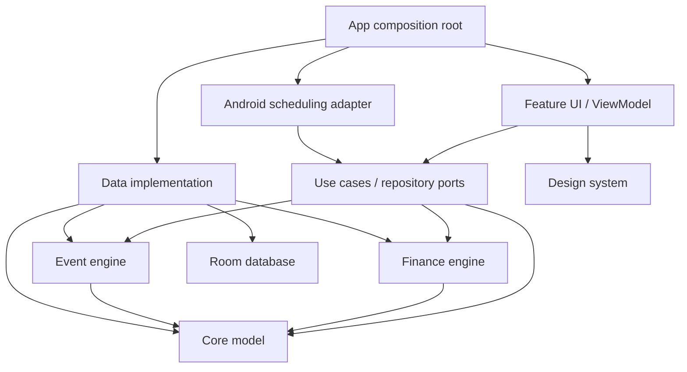

# Системная архитектура Credivaro v1.0

## 1. Цели и границы
Local-first, нативный Android, Kotlin, Compose, Material 3, Room, DataStore. UDF/MVVM: UI передаёт события ViewModel, получает неизменяемый UiState через StateFlow; повторное открытие восстанавливает данные из БД. Репозитории — граница домена и платформы. Финансовый код не импортирует Android, Room, UI или сеть. В MVP ручной учёт, платежи, календарь, напоминания, настройки; банковские подключения и облако отсутствуют.

## 2. Целевая структура
| Модуль | Ответственность |
|---|---|
| :app | composition root, навигация, внедрение зависимостей |
| :core:model | UUID, деньги, даты, доменные модели и интерфейсы портов |
| :core:finance | чистые алгоритмы финансовых оценок, агрегатов и сценариев |
| :core:events | чистый генератор финансовых событий |
| :core:database | Room entities, DAO, миграции, транзакции |
| :core:data | отображение entities в domain, реализации репозиториев, транзакционные команды |
| :core:notifications | планировщик, receiver/worker, системные каналы |
| :core:designsystem | Material 3, Signal Frame, доступные UI-компоненты |
| :feature:dashboard | сводка и ближайшие события |
| :feature:obligations | редакторы и детали обязательств |
| :feature:payments | ввод, исправление и история платежей |
| :feature:calendar | календарь и настройки событий |
| :feature:settings | язык, тема, приватность и диагностика |

Для первого вертикального среза достаточно :app, :core:model, :core:finance, :core:events, :core:database, :core:data; feature и platform пакеты могут жить в :app до возникновения реальной необходимости разделения. Не создавать пустые модули. Никаких зависимостей feature -> feature; навигация через идентификаторы маршрутов, не передаёт финансовые объекты целиком.

Use cases и порты на первом этапе в core:model или отдельном domain-пакете; при росте — отдельный :core:domain. Реализации подключаются в :app. Kotlin coroutines/Flow; dispatcher и Clock инъецируются. Вычисления вне main thread. DI на первом этапе через явный composition root; Hilt или другой контейнер — после оценки необходимости.

## 3. Команды и чтение
Команды: CreateObligation, UpdateTerms, RecordPayment, CorrectPayment, ReconcileBalance, SetEventRule, SetReminderRule, CloseObligation, ArchiveObligation. Validate -> транзакция записи + пересчёт проекций/запись durable scheduling intent -> commit -> согласование системных заданий. Внешние эффекты не выполняются внутри SQL-транзакции. Идемпотентность через operationId; если процесс погиб после commit, intent подбирается повторно. Команда возвращает типизированный результат, не скрывает ошибку.

Query: ObserveDashboard, ObserveObligations, ObserveCalendar(range), ObservePayments(id), ObserveNotificationHealth. Room Flow — источник локальных фактов, derived UI state строится через use case. Денежные итоги группируются по валюте, неизвестные значения отмечаются отдельно. Список датированного банка и расчётных оценок не объединять в один недостоверный итог. Пустые/ошибочные/неполные состояния имеют отдельные представления.

## 4. Финансовое ядро
Value objects Money(currency, minorUnits), Rate(decimalString), BankDate(LocalDate, zoneId), CalculationAssumptions, CalculationResult(value?, completeness, reasons, algorithmVersion, asOf). Точная арифметика с проверкой переполнения; BigDecimal для ставок и промежуточных расчётов, политика округления задана явно. Валюта и шкала определяются при создании операции. Смена валюты договора не меняет исторические записи; требуется новый договор или явная миграция с документированным курсом.
Use cases: allocation validation, confirmed/estimated balance, remaining planned amount, per-currency aggregate, schedule estimate. Неизвестное распределение не уменьшает тело долга автоматически. Банковские факты имеют приоритет; прогноз не обновляет подтверждённый снимок. Стратегии 1.x — чистая симуляция с ограничением горизонта и пояснениями. Формулы и тестовые примеры в требованиях PR #2.

## 5. Навигация
Dashboard -> Obligations -> Obligation detail -> Edit terms / Payments / Events.
Dashboard или Calendar -> Event detail -> Record payment / Edit reminder.
Settings -> Theme / Language / Notifications / Privacy / About.
Bottom nav MVP: Главная, Обязательства, Календарь, Ещё. Аналитика становится отдельной вкладкой только при наличии реализации. Маршрут содержит UUID; ViewModel получает данные из репозитория. Back stack, process death, deep link из уведомления и удалённый объект должны обрабатываться безопасно. Нет обязательного onboarding аккаунта.

## 6. Проверки
JVM: money/rate, allocation, schedule, recurrence, date/time and DST, aggregates, unknown data, idempotence. Room instrumentation: transaction rollback, unique/FK constraints, migrations (export schemas), restart recovery. Scheduler tests: fake clock/adapter and real-device tests for permissions, restart, time zone, OS restrictions. Compose tests: navigation, validation, empty states, accessibility; RU/EN and dark/light. CI: Gradle wrapper, lint, unit tests, assembleDebug; instrumented tests on emulator as separate job. No release signing secret in Git. SDK/AGP/Kotlin/JDK versions pinned after compatibility check, not guessed here.
