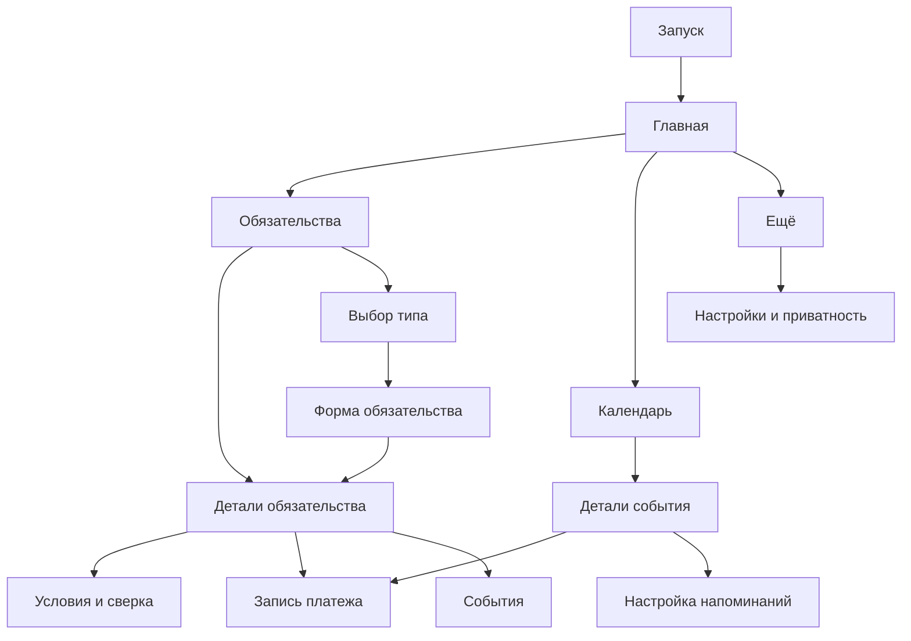

# Экраны и навигация

Статус: UX-спецификация для итераций alpha, не обещание реализации всех экранов в первой сборке.

## 1. Navigation
Compact bottom bar: Главная / Обязательства / Календарь / Ещё. На широких экранах возможен navigation rail. Аналитика становится отдельным пунктом только после реализации. Для первого вертикального среза отображать лишь работающие маршруты. Не показывать пустые заглушки как готовые функции. Состояние выбранного раздела сохраняется; системный Back работает предсказуемо. Detail route carries only UUID. Notification deep link opens appropriate event after app unlock; missing or deleted item produces safe message.



## 2. Dashboard — Главная
Header: brand title, privacy toggle, optional settings action. BalanceSummary grouped by currency with as-of date and source. Show confirmed and estimated values separately; missing obligations count displayed. Upcoming required amounts for selected month grouped by currency (remaining, not duplicate full grace goals). Possible overdue events and upcoming list ordered by date. CTA «Добавить обязательство» prominent in empty state, add action available in normal state. No charts of synthetic progress on real empty screen.
Example only: confirmed RUB 125 000 at 24.11.2026; known upcoming 8 500 RUB; «2 обязательства, 1 остаток не указан». Do not imply exact complete total.
Wireframe:
```text
Credivaro                         [eye]
Подтверждённые остатки
125 000 ₽      на 24 ноя
1 остаток не указан
К оплате в этом месяце       8 500 ₽
Ближайшие события             Все >
27 ноя   Платёж по кредиту    6 000 ₽
29 ноя   Окончание льготы   Подробнее
[ + Добавить обязательство ]
Главная | Обязательства | Календарь | Ещё
```

## 3. Obligations — Обязательства
List with search, type/status filter, sort by next event or user choice, add action. Each card: name, creditor, type, known balance with source, next known event, status. Currency-specific sorting only or explicit non-money sort across currencies. Empty state provides add action. Archive accessible via filter. Do not rely on swipe-only gestures.

## 4. Add / edit obligation
Step 1 type: credit, card, installment, other/manual. Step 2 essentials: name, creditor label optional, currency, initial amount/confirmed outstanding amount if known, date of balance, bank zone. Step 3 product terms and events (may defer). Step 4 review and save. Progressive disclosure; optional values explicitly «Не знаю / позже». Show inline errors; preserve draft across rotations, avoid duplicates on repeated submit, confirm discard. No bank credentials.
Credit: principal, annual rate/method, dates, term, payment schedule/source, amount and frequency, fees/prepayment rule optional.
Card: limit, balance, cycle and statement date, minimum payment, grace groups, separate cash-withdrawal limit/reset and relevant fees/rates. Fields expandable by section. Do not infer grace from generic card name.
Installment: original amount, down payment, amount and count, dates, fees and rate if known.
Other: manual terms and events. Only enable controls backed by working domain behavior; defer unsupported complex rules explicitly.
On edit, explain effective date; do not rewrite historical payment records.

## 5. Obligation detail
Header name/type/lender/status. Balance with bank-as-of and source; action «Сверить остаток». Next mandatory payment and other events. Sections or tabs: overview, terms, payment history, events. Main CTA «Записать платёж». Secondary actions edit terms, add event, archive/close, delete with confirmation. Show partial/estimated values distinctly. Closed status does not imply bank verification. No actual payment execution.

## 6. Payments and balance reconciliation
Payment form: amount, currency inherited, paid date, optional allocation by principal/interest/fees/unknown, link to event optional, note, review. Invalid amount, mismatched currency, over-allocation blocked with explanation. Unknown allocation allowed, estimated principal flagged incomplete. Correction/reversal retains history. Reconciliation form: bank-confirmed as-of date, known balance fields, source user-entered statement; replaces displayed latest snapshot but retains past facts. No bank login or automatic transaction.

## 7. Calendar
Month header navigation and Today action, selectable date, event dots/indicators with textual descriptions and a chronological agenda. Filter by obligation/type/status. Monthly total only known mandatory amounts per currency; unknown sum count and alternative grace targets separate. Each day can list several events; expanded list supports TalkBack. Event detail shows source, banking zone/deadline, amount, linked payments, recurrence/exception and reminders. Add manual event. Date correction edits rule or instance explicitly, not silently both.

## 8. Reminders
Event detail -> rule editor. Multiple offsets, time, preview next dates, enabled, privacy, snooze/quiet hours. Inheritance clearly indicated with reset-to-default action. Show Android permission state and open settings if needed; denied permission never blocks calendar. Generic notification text default; deep link to correct event. No promise that OS will deliver precisely.

## 9. Settings
Theme: system/light/dark; language: system/RU/EN; privacy: mask dashboard, generic notification content; notification diagnostics; About: installed version, alpha warning, license and repository link. Security: only implemented options visible; app lock and backup must not appear functional before verified. No required account. No cloud integration in initial alpha.

## 10. Shared states
Loading (short local reads), empty, validation, recoverable errors, unknown values, incomplete estimates, stale bank snapshot, denied notification permission, possible overdue. Never use false balances, hidden sample data or a success message when a write failed. Review all states in both themes and locales.
